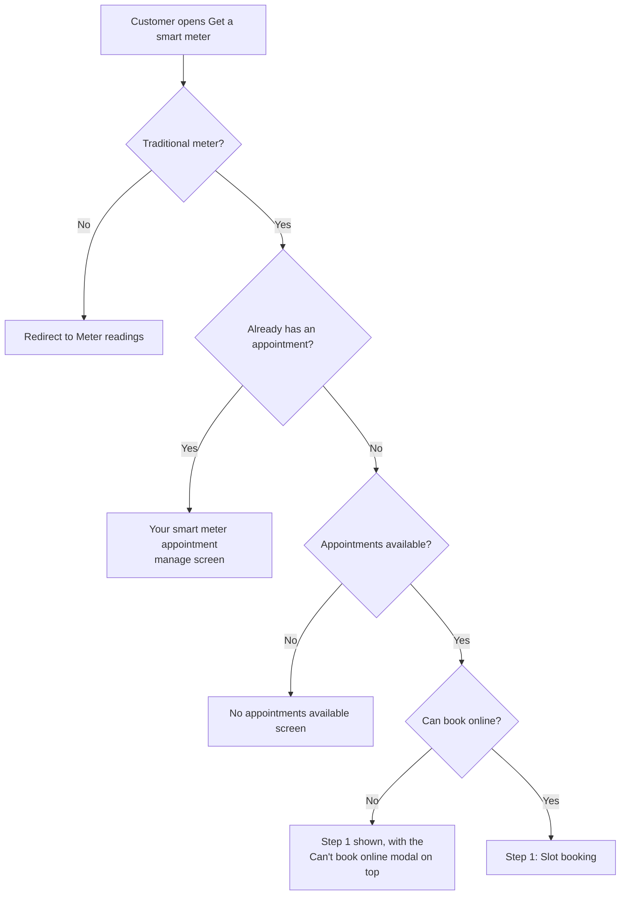
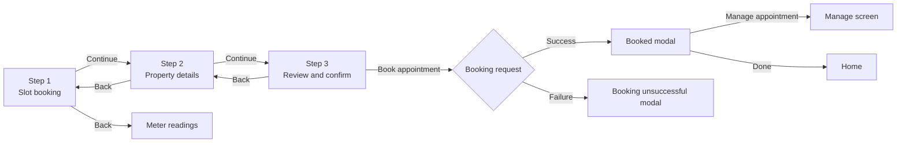
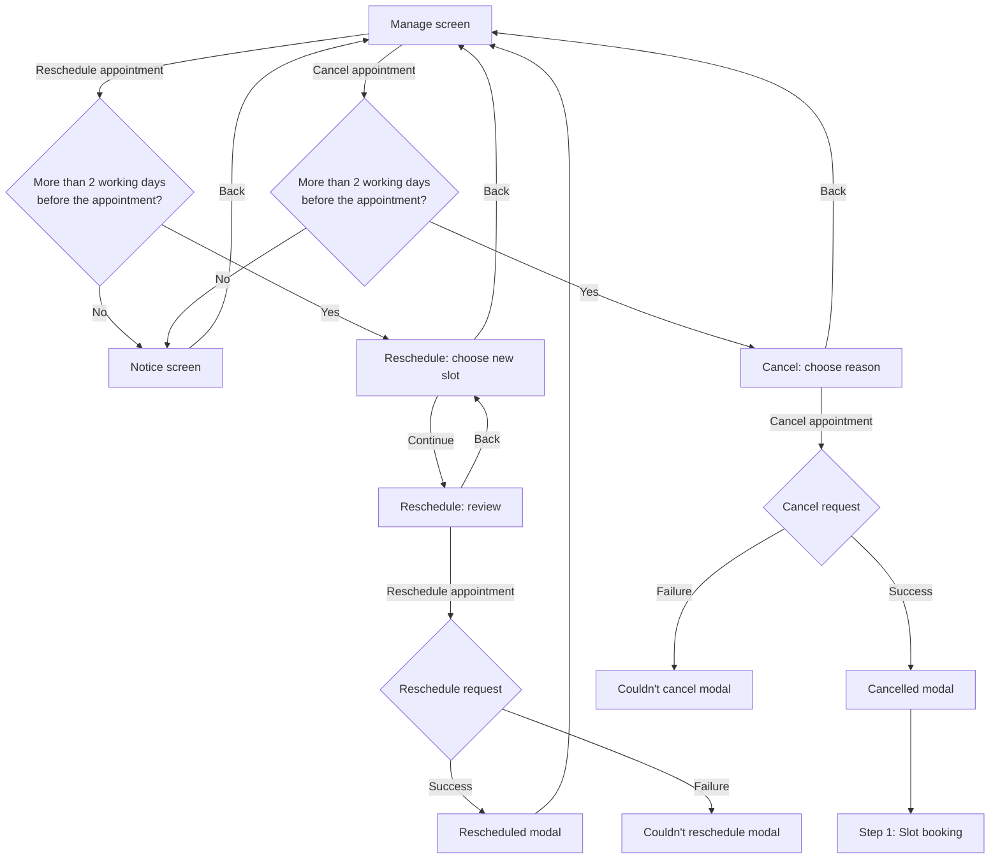

# Get a smart meter: frontend flow

This document describes the **Get a smart meter** journey as built in the Home Energy portal prototype, so the Jira requirements and the frontend build match.

- Prototype page: `booking.html` (live: https://home-energy-requirement-v2.netlify.app/booking)
- Logic: `initBooking()` in `js/app.js`
- All screen wording below is copied from the prototype. Text in `[square brackets]` is filled in from data.

---

## 1. Who can use it

| Rule | Behaviour |
|---|---|
| Only customers with a **traditional (non-smart) meter** | The **Get a smart meter** menu item, with a **New** badge, appears in the side menu (desktop) and the menu sheet (mobile) only for these customers. |
| Smart meter customers, including those whose smart meter is not communicating | The menu item is hidden. If they open the page directly, they are sent to **Meter readings** (`readings.html`). |
| Customer type changes while on the page | If the customer is no longer traditional, they are sent to **Meter readings**. |

**Entry point:** the side menu item **Get a smart meter**. There is no other entry point in the prototype.

---

## 2. What the customer sees when they open the page

---

## 3. Booking journey (new appointment)

The page title is **Get a smart meter** on all three steps. A step indicator shows **Step X of 3: [step name]** with a 3-part progress bar.

### Step 1 of 3: Slot booking

| Element | Content |
|---|---|
| Heading | **Choose your appointment** |
| Lead text | Select a time window that suits you, and our engineer will arrive within it. |
| Site address | Label **Site address**, then the customer's supply address |
| Date picker | Label **Select a date**, placeholder **Choose a date** |
| Time | Label **Select time**, options: **Morning, 8AM to 12PM** and **Afternoon, 12PM to 4PM** |
| Buttons | **Back** (goes to Meter readings), **Continue** |

**Rules**
- **Dates offered:** the next **7 working days**, starting from the **3rd working day** after today. Saturdays and Sundays are skipped, which gives 2 working days' notice. Dates show as, for example, "Thursday, 19 November 2026".
- **Evening:** not offered on a new booking. It is offered only when rescheduling (see section 4).
- **Continue** stays disabled until **both** a date and a time are chosen.

### Step 2 of 3: Property details

| Element | Content |
|---|---|
| Heading | **Tell us about your property** |
| Lead text | These answers help the engineer arrive with the right kit. |
| Helper | Questions marked with * are mandatory |
| Buttons | **Back** (Step 1), **Continue** |

**Mandatory questions (single choice)**

| Question | Options | Label used on the review screen |
|---|---|---|
| Is your meter above head height? * | Yes / No | Meter above head height |
| Are there any pets in the property? * | Yes / No | Pets |
| Are there any parking restrictions? * | Permit required / On street parking / Pay and display / Other / No | Parking |
| Is it a shared supply? * | Yes / No | Shared supply |

**Optional: "Is there anything we should know?"** These are toggle chips, and the customer can select any number of them:
- Medical equipment at home
- Disability or mobility need
- Hearing or sight loss
- Someone over 75 at home
- Children under 5 at home

**Rules**
- **Continue** stays disabled until all 4 mandatory questions are answered.
- Chips are optional and never block **Continue**.

### Step 3 of 3: Review and confirm

| Element | Content |
|---|---|
| Heading | **Review and confirm** |
| Lead text | Please check your details before confirming your appointment. |
| Meter | Electricity & Gas |
| Appointment details | **Date & time:** "[Weekday], [19th] [Month] [Year] - [Slot]", for example "Thursday, 19th November 2026 - Morning, 8am to 12pm". **Address:** the site address |
| Property details | Each answer, for example "Pets: No" |
| Vulnerability | A numbered list of the selected chips, or **None** if none were picked |
| Buttons | **Back** (Step 2), **Book appointment** |

**While submitting:** the button changes to **Booking…** and is disabled until the response comes back.

### Booking result

| Result | Modal title | Modal text | Buttons |
|---|---|---|---|
| Success | Your smart meter appointment has been booked | If you need to make any changes, you can manage your appointment through your account. **Please note:** You'll need to give us 2 working days' notice to reschedule or cancel. | **Manage appointment** (manage screen), **Done** (Home) |
| Failure | Your smart meter booking was unsuccessful | Unfortunately, we couldn’t complete your booking. Please try again later, or contact us for assistance. | **Contact us** |

On success, the booking is saved and the page underneath switches to the manage screen.

---

## 4. Managing an existing appointment

### Manage screen

The page title is **Your smart meter appointment**.

| Element | Content |
|---|---|
| Intro | You have an existing smart meter exchange appointment scheduled. If you need to, you can easily amend or cancel your booking. Select the appropriate option below to update your appointment details. |
| Note | **Please note:** We need a minimum of 2 working days' notice to reschedule or cancel your appointment. |
| Appointment details | **Date & time** and **Address** (same format as the review screen) |
| Buttons | **Cancel appointment**, **Reschedule appointment** |

### Notice screen (too close to the appointment)

Shown instead of the reschedule or cancel screens when the appointment is less than 2 working days away. The page title is **Your smart meter appointment**.

- **Heading:** We need a minimum of 2 working days' notice to reschedule or cancel your appointment.
- **Text:** To make changes to your appointment, please contact us and we’ll be happy to help.
- **Buttons:** **Back** (manage screen), **Contact us**

### Reschedule: choose a new slot

The page title is **Reschedule appointment**. There is no step indicator.

| Element | Content |
|---|---|
| Intro | Choose a new date and time. Your engineer will arrive within the window you pick. |
| Date picker | Label **Select date**, placeholder **DD/MM/YYYY**. The same 7 working days as Step 1 |
| Time | **Morning, 8AM to 12PM**, **Afternoon, 12PM to 4PM**, **Evening, 4PM to 8PM** |
| Reason (dropdown) | Label **Reason for rescheduling**, placeholder **Choose a reason**. Options: I have been unexpectedly called into work / I won't be at home at that time / Someone else will be at home on another day / Other |
| Buttons | **Back** (manage screen), **Continue** |

**Rules**
- **Continue** stays disabled until a date, a time **and** a reason are all chosen.
- Previous choices are cleared each time the customer starts a reschedule.

### Reschedule: review

| Element | Content |
|---|---|
| Heading | **Review and confirm** |
| Lead text | Please check your details before confirming your rescheduled appointment. |
| Rescheduled appointment details | **Date & time** (new slot), **Address** |
| Reason for rescheduling | The chosen reason |
| Buttons | **Back**, **Reschedule appointment** (shows **Rescheduling…** while submitting) |

| Result | Modal title | Modal text | Buttons |
|---|---|---|---|
| Success | Your smart meter appointment has been rescheduled | Your appointment has been updated. You can make further changes from your account. | **Manage appointment**, **Done** (Home) |
| Failure | We couldn’t reschedule your smart meter appointment | Sorry, we weren’t able to reschedule your appointment right now. Please try again later or contact us for assistance. | **Contact us** |

### Cancel

The page title is **Cancel appointment**.

| Element | Content |
|---|---|
| Intro | Tell us why you're cancelling. You can book a new appointment any time through your online account. |
| Reason (dropdown) | Label **Reason for cancelling**, placeholder **select your reason**. Options: No longer required / Changed supplier |
| Buttons | **Back** (manage screen), **Cancel appointment** (shows **Cancelling…** while submitting) |

**Rule:** **Cancel appointment** stays disabled until a reason is chosen.

| Result | Modal title | Modal text | Buttons |
|---|---|---|---|
| Success | Your smart meter appointment has been cancelled | If you change your mind, you can book a new appointment from your account. | **Book appointment** (Step 1), **Done** (Home) |
| Failure | We couldn’t cancel your smart meter appointment | Sorry, we weren’t able to cancel your appointment right now. Please try again later or contact us for assistance. | **Contact us** |

On a successful cancel, the saved appointment and all booking answers are cleared, and the page returns to Step 1.

---

## 5. Unavailable states

| State | When | What the customer sees |
|---|---|---|
| No appointments available | No slots can be offered for this customer | The page title is **Get a smart meter**. **Heading:** We're not able to provide you with a smart meter booking right now. **Text:** To register your interest in a smart meter, please contact us and we'll be able to help. **Button:** **Contact us** |
| Can't book online | The customer is eligible but must book by phone | A modal over Step 1. **Title:** We’re unable to book your smart meter online. **Text:** Please contact us so we can help arrange your smart meter booking. **Button:** **Contact us**. The same modal also appears if they press **Book appointment**. |

---

## 6. Behaviour that applies to every screen

- **Changing screens:** focus moves to the page heading and the page scrolls to the top. Reduced-motion settings are respected.
- **Modals:** these are native dialogs, so focus is trapped inside. They close with **Escape** or by clicking outside the box.
- **Date picker:** a listbox. Arrow up and down move through dates, **Escape** closes it, and clicking outside closes it.
- **Time slots:** a radio group. Arrow keys move between the slots and select them.
- **Chips:** toggle buttons (`aria-pressed`).
- **Disabled buttons:** primary buttons stay disabled until their required fields are filled.
- **Progress bar:** announces "Step X of 3" to screen readers.

---

## 7. Data the frontend needs from the backend

The prototype fakes these calls. Each row below is a call the real build needs. Field names are suggestions to agree with the backend team.

| When | Call | Needs back |
|---|---|---|
| Page load | Get eligibility and any existing appointment | Meter type (traditional or smart), can book online (yes or no), existing appointment (date, slot, address) or none |
| Step 1 and reschedule | Get available slots | List of dates, each with the slots offered (morning, afternoon, evening). Empty list means the "No appointments available" state |
| Book appointment | Create booking | Date, slot, the 4 property answers, the selected vulnerability needs. Returns success or failure |
| Reschedule appointment | Update booking | New date, new slot, reason. Returns success or failure |
| Cancel appointment | Cancel booking | Reason. Returns success or failure |
| Manage screen | Check the notice rule | Whether the appointment is more than 2 working days away (or the frontend works it out from the appointment date) |

In the prototype, dates are worked out in the browser and Monday to Friday counts as working days. **Bank holidays are not handled**, so the real slot list should come from the backend.

---

## 8. Points to confirm before writing the Jira tickets

1. **Evening slot:** it is offered when rescheduling but not on a new booking. Is that intended?
2. **Time wording:** the slot buttons say "8AM to 12PM", but the review screens say "8am to 12pm". Pick one style.
3. **Cancel reasons:** only "No longer required" and "Changed supplier". Is an "Other" option needed?
4. **Contact us:** where should it go (phone number, contact page or chat)? It isn't wired up in the prototype.
5. **Bank holidays:** confirm they are excluded from the 2 working days' notice and from the dates offered.
6. **Meter wording:** the review screen always says "Electricity & Gas". Should it reflect single-fuel customers?
7. **Other entry points:** should the journey also be linked from Home or Meter readings, not just the side menu?

---

## 9. How to see every state in the prototype

On `booking.html`, set the customer to **Traditional meter**. Then open **Prototype** and choose a **Booking outcome**:

| Prototype option | Shows |
|---|---|
| Everything works | The normal journey and successful results |
| Booking, reschedule or cancel fails | The 3 failure modals |
| Can't book online | The "unable to book online" modal |
| No appointments available | The no-slots screen |
| Appointment is within 2 working days | The notice screen when rescheduling or cancelling |

**Clear the booked appointment** removes a saved booking so you can start again from Step 1.
