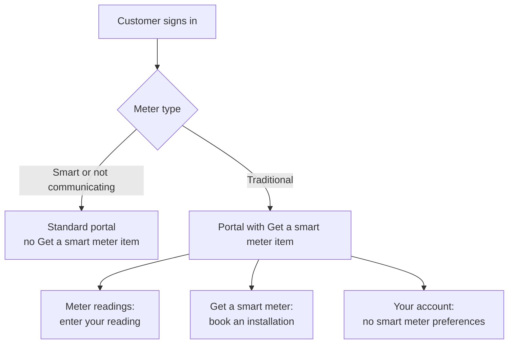
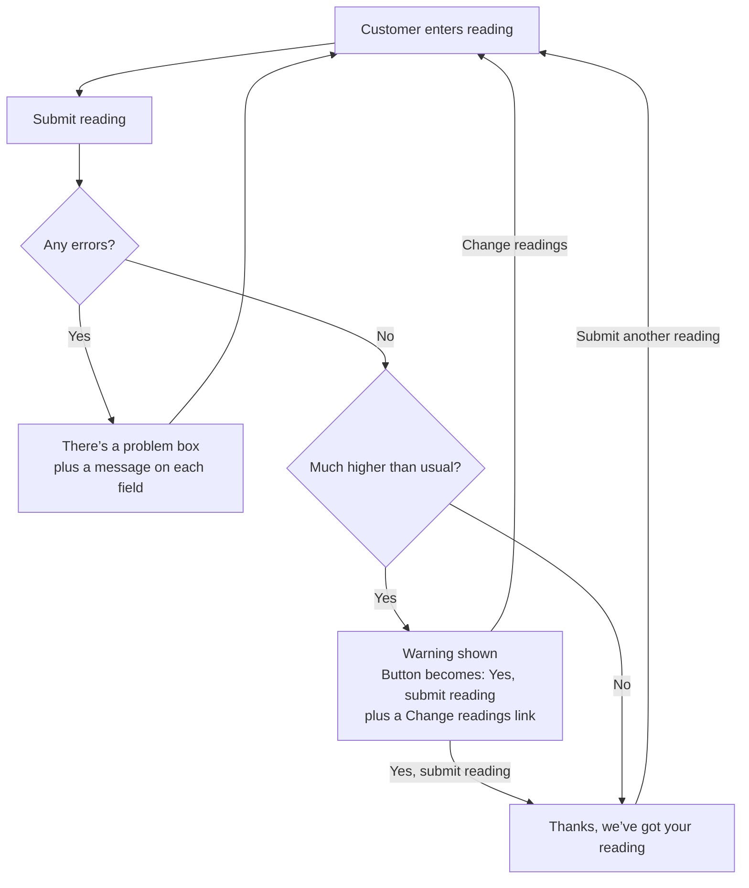
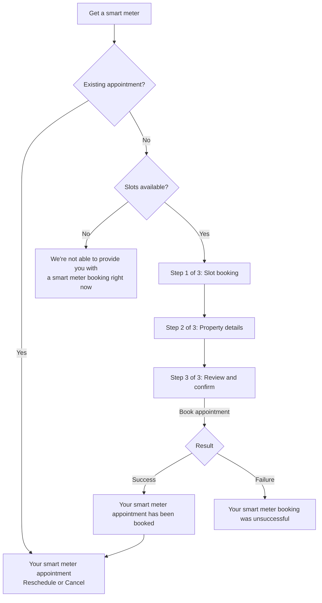

# Traditional meter customers: UX and frontend flow

This document describes everything a **traditional (non-smart) meter customer** sees in the Home Energy portal prototype: what is different for them, how they submit meter readings, and how they book a smart meter (SMS, the smart meter booking flow). Use it to align the Jira requirements with the frontend build.

- Prototype: https://home-energy-requirement-v2.netlify.app
- Meter readings: `readings.html`, logic in `initReadings()` in `js/app.js`
- Get a smart meter: `booking.html`, logic in `initBooking()` in `js/app.js`
- The full screen-by-screen wording for the booking flow is in [`get-a-smart-meter-flow.md`](get-a-smart-meter-flow.md). Section 4 below is a summary of it.
- All wording below is copied from the prototype. Text in `[square brackets]` is filled in from data.

---

## 1. How the portal knows the customer has a traditional meter

The portal has three customer types:

| Customer type | Meaning |
|---|---|
| Smart meter | Readings arrive automatically |
| Not communicating | Smart meter, but it has stopped sending readings. The last reading is still on the account |
| **Traditional meter** | No smart meter. The customer types in their own readings and can book a smart meter |

In the prototype, the type is chosen from the **Prototype** menu in the header (**Choose a customer → Traditional meter**). In the real build, it must come from the account data the backend returns at sign-in.

---

## 2. What is different for a traditional meter customer

| Where | Smart meter customer | Traditional meter customer |
|---|---|---|
| Side menu and mobile menu | No smart meter booking item | **Get a smart meter** item at the top of the menu, with a **New** badge |
| Meter readings | "Your smart meter is sending us readings", latest readings shown, plus "Want to send a manual reading?" | "Enter your meter reading" form (section 3) |
| Meter reading history | Sources include "Submitted by your smart meter" | Every smart meter source shows as "Submitted by you" instead |
| Your account | Shows **Smart meter preferences** (reading frequency) in the list, the overview tile and the section | All smart meter preferences are hidden |
| Get a smart meter page | Redirected to Meter readings | Can use the booking flow (section 4) |
| Moving out | A meter reading for the moving date can be filled in from the smart meter | No automatic reading. The customer enters it themselves |

---

## 3. Meter readings (traditional meter)

### 3.1 Page layout

From top to bottom:

1. **Page title:** Meter readings.
2. **Supply address picker:** on mobile it sits under the title. On desktop it is in the header.
3. **Fuel switch:** **Electricity** / **Gas** (a radio group, where the left and right arrow keys move between them).
4. **Meter card:**
   - **Heading:** Enter your meter reading.
   - **Meter details:** two tiles, each with a copy button:

     | Fuel | Tile 1 | Tile 2 |
     |---|---|---|
     | Electricity | **MPAN** [number] | **Meter serial number** [number] |
     | Gas | **MPRN** [number] | **Meter serial number** [number] |

     The copy button says "Copy [Meter Point Administration Number]" to screen readers and shows a toast once the value is copied.
   - **Reading form:** see 3.2.
5. **Meter reading history:** see 3.6.

### 3.2 Reading fields

| Fuel | Fields | Unit | Under each field |
|---|---|---|---|
| Electricity | **DY-Day reading** and **NT-Night reading** | kWh | Previous reading **[35,137 kWh]** on [25 April 2026] |
| Gas | **Enter reading** | m³ | Previous reading **[8,462 m³]** on [23 September 2026] |

- **Input:** a numeric keypad on mobile (`inputmode="numeric"`), placeholder "Enter reading", with the unit shown inside the field.
- **Commas:** allowed and ignored (35,200 is read as 35200).
- **Buttons:** **Submit reading**, plus a help line: "Having trouble entering your meter reading? **Click here** ⓘ".

### 3.3 Validation rules

Each field is checked when the customer leaves it (if they typed something) and again when they press **Submit reading**.

| Check | Type | Message |
|---|---|---|
| Field is empty | Error | Enter your day reading / Enter your night reading / Enter your reading |
| Not just numbers | Error | Use numbers only. Don’t include spaces, letters or decimal points |
| More than 8 digits | Error | A reading can’t be longer than 8 digits |
| Lower than the previous reading | Error | This is lower than your previous [day ]reading of [35,137] [kWh]. Check the number and try again |
| Much higher than usual (more than 3,000 kWh above the previous electricity reading, or 500 m³ for gas) | **Warning** | This is much higher than usual. Check the number, or submit it if it’s right |

- **Errors** block submission. After a failed submit, a box at the top headed **There’s a problem** lists every error, and each field shows its own message in red.
- **Warnings** do not block submission, but the customer must confirm (see 3.4).
- A field that passes the checks gets a "valid" style once the customer has left it.

### 3.4 Submitting a reading

- **Confirming a high reading:** when there is a warning, the button changes to **Yes, submit reading** and a **Change readings** link appears. Typing in a field resets the button to **Submit reading**.
- **Success panel:**
  - **Title:** Thanks, we’ve got your reading.
  - **Text:** We’ll use it for your next bill.
  - A summary of the reading submitted, for example "DY-Day reading 35,200 kWh" and "NT-Night reading 17,900 kWh". For gas, it says "Reading [value] m³".
  - Link: **Submit another reading** (clears the form).
- **Fuel switch:** each fuel keeps its own form state. Switching between Electricity and Gas does not lose what was typed.

### 3.5 Help: "How to read your meter"

**Click here** opens and closes a help panel under the form (`aria-expanded` is set on the link).

| Fuel | Steps |
|---|---|
| Electricity | 1. Find the meter cupboard. 2. Skip red digits. 3. DY is day, NT is night |
| Gas | 1. Find the meter box. 2. Skip red digits and decimals. 3. Use the m³ figure |

### 3.6 Meter reading history

- **Title:** Meter reading history. It can be collapsed and expanded.
- **Under the title:** Meter Serial Number: **[serial]**.
- **Each entry:** date, readings (Day Reading and Night Reading for electricity, or Reading for gas) and source.
- **Sources a traditional customer sees:** "Last reading on your account", "Submitted by you", "Estimated based on your past usage".
- **Load More:** 4 entries are shown at first, and **Load More** shows the rest.
- **Download:** downloads the history as a spreadsheet file (`electricity-meter-readings.csv` or `gas-meter-readings.csv`) and shows the toast "Meter reading history downloaded".

---

## 4. Get a smart meter (smart meter booking)

The full wording, rules and states are in [`get-a-smart-meter-flow.md`](get-a-smart-meter-flow.md). This is the summary.

**Entry point:** the **Get a smart meter** menu item. Only traditional meter customers can open the page. Anyone else is sent to Meter readings.

| Step | What the customer does | Rules |
|---|---|---|
| 1. Slot booking: "Choose your appointment" | Picks a date and a time (Morning, 8AM to 12PM, or Afternoon, 12PM to 4PM) | The next 7 working days, starting 3 working days from today. **Continue** is disabled until both are chosen |
| 2. Property details: "Tell us about your property" | Answers 4 required questions (meter above head height, pets, parking restrictions, shared supply), plus optional "Is there anything we should know?" chips | **Continue** is disabled until all 4 are answered |
| 3. Review and confirm | Checks the appointment, address, answers and vulnerability needs | **Book appointment** shows "Booking…" while it submits |

**Managing the booking:**
- **Reschedule:** pick a new date and time (Evening, 4PM to 8PM, is also offered here) and a reason, then review and confirm.
- **Cancel:** choose a reason, then confirm.
- **2 working days' notice:** both need at least 2 working days' notice. Closer than that, the customer sees "We need a minimum of 2 working days' notice to reschedule or cancel your appointment" and a **Contact us** button.

**Other states:**
- **Can't book online:** "We’re unable to book your smart meter online".
- **Failures:** "Your smart meter booking was unsuccessful", or the reschedule and cancel equivalents.

---

## 5. Behaviour on every screen

- **Keyboard:** every control can be used by keyboard. The fuel switch and time slots use arrow keys, and modals close with **Escape**.
- **Screen readers:**
  - Error boxes are announced (`role="alert"`) and success panels as status messages (`role="status"`).
  - Fields have labels that include the unit, for example "DY-Day reading in kWh".
- **Mobile:** numeric keypads for readings, and layouts stack into one column.
- **Reduced motion:** the system setting is respected.
- **Dark mode:** supported on every screen.

---

## 6. Data the frontend needs from the backend

| When | Needs |
|---|---|
| Sign-in | Meter type (smart, not communicating, traditional), for each fuel if they can differ |
| Meter readings page | For each fuel: MPAN or MPRN, meter serial number, registers (day/night or single), previous reading and its date, and reading history with source |
| Submit reading | Accepts the reading for each register. Returns success or failure, and ideally the server's own checks (for example "lower than previous") |
| Validation limits | The "much higher than usual" limit for each fuel. The prototype uses fixed values (3,000 kWh and 500 m³) |
| Get a smart meter | See section 7 of [`get-a-smart-meter-flow.md`](get-a-smart-meter-flow.md) |

---

## 7. Points to confirm before writing the Jira tickets

1. **Submitting a reading can't fail in the prototype:** what should the customer see if the server rejects it or is unavailable?
2. **Field labels:** "DY-Day reading" and "NT-Night reading" match the letters on the meter. Are these the final labels?
3. **"Much higher than usual" limits:** should they be fixed, or based on the customer's own usage?
4. **Single-rate electricity meters:** the prototype always shows day and night fields for electricity. How should a single-register meter look?
5. **Electricity-only or gas-only customers:** should the fuel switch be hidden when there is only one fuel?
6. **Promoting smart meters:** should the Meter readings page also link to **Get a smart meter**? Right now the menu item is the only way in.
7. **Mixed meters:** if a customer has one smart meter and one traditional meter, which experience should each fuel get?

---

## 8. How to see these screens in the prototype

1. Sign in, then open **Prototype** in the header and choose **Traditional meter**.
2. **Meter readings:** try these entries to see each message:
   - Empty fields.
   - Letters.
   - A number lower than the previous reading.
   - A number more than 3,000 above the previous reading.
3. **Get a smart meter:** use **Prototype → Booking outcome** to see each booking result. **Clear the booked appointment** starts again from Step 1.
